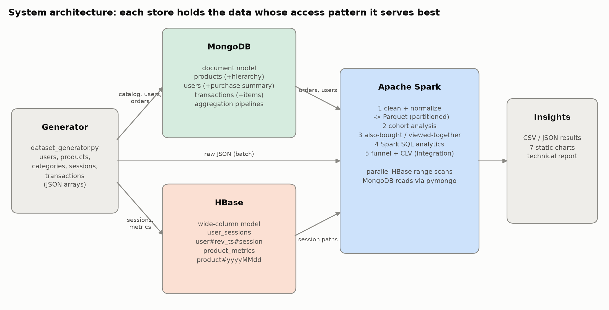

# Distributed Multi-Model Analytics for E-commerce Data

AUCA Big Data Analytics — Final Project.
MongoDB (document model) + HBase (wide-column model) + Apache Spark (distributed processing) on a synthetic e-commerce dataset.



## What's in the repo

| Path | Purpose | Assignment part |
|---|---|---|
| `data_gen/dataset_generator.py` | Course generator as a script, with `--scale` and seeded IDs (logic unchanged; original kept alongside) | Dataset |
| `docker-compose.yml` | MongoDB 7 + single-node HBase 2.1 (Thrift on 9090) | Setup |
| `config.py`, `shared.py` | Shared settings and helpers (row keys, subcategory derivation) | — |
| `mongodb/load_mongodb.py` | Document model + loader + indexes + embedded purchase summaries | 1 |
| `mongodb/aggregations.py` | 3 aggregation pipelines: revenue/profit by category & month, RFM segments, product popularity (`$facet`) | 1 |
| `hbase/create_schema.hbase` | HBase shell schema: `user_sessions`, `product_metrics` | 1 |
| `hbase/load_hbase.py` | Loads sessions (wide, sparse page-view columns) and daily product metrics | 1 |
| `hbase/query_hbase.py`, `hbase/sample_queries.hbase` | Row-key range scans: recent sessions, time-window, journey, product time series | 1 |
| `spark/01_clean_normalize.py` | Cleaning, normalisation, flattening to Parquet, data-quality report | 2 |
| `spark/02_cohort_analysis.py` | Cohort analysis (registration month × purchase month) | 2 |
| `spark/03_recommendations.py` | "Bought together" and "viewed together" (support, confidence, lift) | 2 |
| `spark/04_spark_sql_analytics.py` | Six Spark SQL queries over MongoDB/HBase-named views | 2 |
| `integration/funnel_clv_analysis.py` | Funnel conversion + 12-month CLV, reading HBase and MongoDB directly | 3 |
| `visualization/*.py` | Architecture diagram + 7 static charts | 4 |
| `output/` | All results (CSV/JSON) and charts (`output/charts/`) from the reference run | 4 |
| `report/TECHNICAL_REPORT.md` / `.pdf` | Technical report (`build_pdf.sh` / `build_pdf.ps1` rebuild the PDF) | Report |
| `setup_windows.ps1`, `run_all.ps1`, `*.bat` | Windows setup and pipeline (PowerShell equivalents of `run_all.sh`) | Setup |

## Running on Windows

Native Windows 10/11 with PowerShell (no WSL needed). The scripts were checked with PowerShell's parser and run end to end with PowerShell 7; the Windows-specific parts (winutils, `.venv\Scripts`) can only be exercised on a Windows PC.

**1. Install these once** (open a *new* PowerShell window after installing, so PATH updates):

| Tool | Where | Notes |
|---|---|---|
| Python 3.11 or 3.12 | https://www.python.org/downloads/ | Tick **"Add python.exe to PATH"**. Avoid 3.13+ for now (some packages lack Windows wheels). |
| Java 17 (Temurin) | https://adoptium.net/temurin/releases/?version=17 | In the installer, enable **"Set JAVA_HOME"**. Spark 4 needs Java 17 or 21. |
| Docker Desktop | https://www.docker.com/products/docker-desktop/ | Uses WSL 2; accept the prompt to enable it. Only needed for MongoDB/HBase. |

**2. Put the project in a simple folder**, e.g. `C:\projects\ecommerce-analytics`. Avoid OneDrive-synced folders (Desktop/Documents are often synced) and paths with spaces: both cause Spark file errors.

**3. Set up and run** in PowerShell from the project folder:

```powershell
cd C:\projects\ecommerce-analytics
powershell -ExecutionPolicy Bypass -File .\setup_windows.ps1   # venv + packages + winutils (once)

docker compose up -d                                           # start MongoDB + HBase
Start-Sleep 60                                                 # HBase needs about a minute
powershell -ExecutionPolicy Bypass -File .\run_all.ps1         # whole pipeline (~6-10 min)
```

Or double-click `setup_windows.bat`, then `run_all.bat`.

Useful options:

```powershell
.\run_all.ps1 -SkipDb        # no Docker: Spark + integration (from files) + charts
.\run_all.ps1 -From 4        # resume from step 4 after fixing an error
.\run_all.ps1 -Scale 0.25    # bigger dataset
```

To run one script by hand, activate the venv first: `.\.venv\Scripts\Activate.ps1`, then for example `python mongodb\aggregations.py`. For the Spark jobs, `cd spark` first (`python 01_clean_normalize.py`).

**Why `setup_windows.ps1` downloads winutils.** Spark writes files through Hadoop, which on Windows needs two helper files: `winutils.exe` and `hadoop.dll`. The setup script saves them to `tools\hadoop\bin`, and `spark\common.py` points Spark at them automatically, so you don't need to change any system settings. If the download fails, get both files from https://github.com/cdarlint/winutils (folder `hadoop-3.3.6\bin`) and copy them into `tools\hadoop\bin`.

**Troubleshooting on Windows**

| Error | Fix |
|---|---|
| `running scripts is disabled on this system` | Use `powershell -ExecutionPolicy Bypass -File .\run_all.ps1`, or the `.bat` files. |
| `UnsatisfiedLinkError ... NativeIO$Windows.access0` or `HADOOP_HOME and hadoop.home.dir are unset` | `winutils.exe`/`hadoop.dll` are missing from `tools\hadoop\bin`; rerun the setup script or copy them by hand. If it persists, also copy `hadoop.dll` to `C:\Windows\System32`. |
| `Python worker failed to connect back` / `Python was not found` | Run through `run_all.ps1` (it sets `PYSPARK_PYTHON`), or activate `.venv` first. Turn off the "python.exe" App execution alias in Windows Settings → Apps → Advanced app settings. |
| `Java gateway process exited` / `JAVA_HOME is not set` | Install Java 17, then open a new terminal. Check with `java -version`. |
| `Exception while deleting Spark temp dir` at the end of a job | Harmless Windows file-locking message; results are already saved. |
| `TTransportException` / connection refused on port 9090 | HBase is still starting: wait a minute, check http://localhost:16010, then `.\run_all.ps1 -From 3`. |
| Docker: `no matching manifest` for HBase on an ARM laptop | Leave `platform: linux/amd64` in `docker-compose.yml`; Docker Desktop emulates it. |
| `MemoryError` in the generator | Use a smaller `-Scale` (0.05) or close other programs; 0.1 needs about 1.5 GB. |

**Alternative: WSL 2.** If native Windows gives you trouble, open Ubuntu in WSL (`wsl --install`), copy the project there and use the Linux commands below (`./run_all.sh`). Docker Desktop is shared with WSL automatically.

## Quick start (Linux / macOS)

Requirements: Python 3.10+, Java 17+ (for Spark), Docker.

```bash
pip install -r requirements.txt
docker compose up -d          # MongoDB + HBase; wait ~60 s for HBase to start
./run_all.sh                  # generate -> load -> Spark -> integrate -> charts
```

No Docker? Run the Spark, integration and chart steps only:

```bash
SKIP_DB=1 ./run_all.sh
```

### Step by step

```bash
# 1. Data (10% scale = 200k sessions, 50k transactions, ~1 min, ~1.5 GB RAM)
python data_gen/dataset_generator.py --scale 0.1 --out data/raw

# 2. MongoDB
python mongodb/load_mongodb.py
python mongodb/aggregations.py

# 3. HBase
docker exec -i ecom-hbase hbase shell < hbase/create_schema.hbase   # optional, loader creates tables too
python hbase/load_hbase.py --files 1
python hbase/query_hbase.py --user user_000042 --product prod_00123 --start 2026-10-01 --end 2026-10-15

# 4. Spark (run from spark/)
cd spark
python 01_clean_normalize.py
python 02_cohort_analysis.py
python 03_recommendations.py
python 04_spark_sql_analytics.py
cd ..

# 5. Integration (reads HBase + MongoDB; use --source files without the databases)
python integration/funnel_clv_analysis.py --source databases

# 6. Charts
python visualization/architecture_diagram.py
python visualization/make_charts.py
```

## Notes

- **Dates are relative to "now".** The generator creates 90 days of activity ending on the day you run it, so your dates will differ from the reference run (Aug–Nov 2026). Because IDs are seeded, the *structure* of the data is reproducible.
- **Full scale** (`--scale 1`, 2M sessions) needs roughly 15–20 GB of RAM because the generator keeps everything in memory. 10% scale is enough for every analysis here.
- **Apple Silicon:** the HBase image is amd64-only and runs under emulation (`platform: linux/amd64` is already set).
- **HBase connection errors:** HBase needs about a minute after `docker compose up`. Check http://localhost:16010, then retry.
- Configuration (hosts, ports, folders, Spark memory) is in `config.py` and can be overridden with environment variables, e.g. `MONGO_URI=mongodb://host:27017`.

## Key results (reference run, 10% scale)

- 200,000 sessions → 25,193 paid orders linked to sessions (12.6%); the biggest losses are cart → checkout (55% drop) and checkout → payment (56% drop).
- The #1 category by revenue is only #13 by estimated profit; the most profitable category is #15 by revenue.
- Sold-out products get 63% fewer page views. Stock-outs suppress demand, not just sales.
- The top 25% of customers hold 46% of predicted 12-month value; engagement metrics barely predict it (r ≤ 0.15).
- 15,338 sessions are labelled "converted" but have no order. This is a generator artefact that the pipeline detects and reports.

See `report/TECHNICAL_REPORT.md` for the full discussion.
