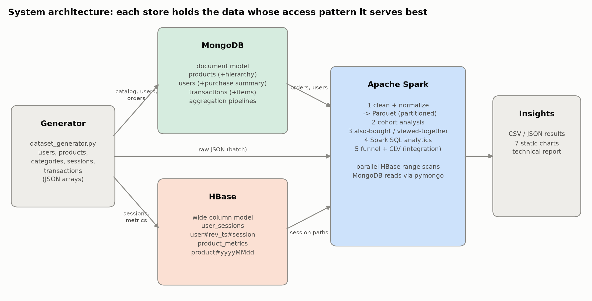
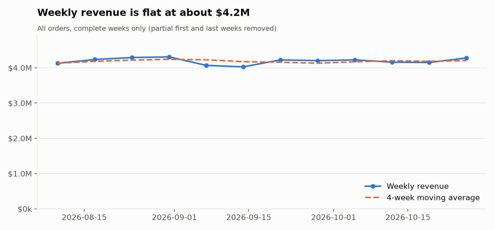
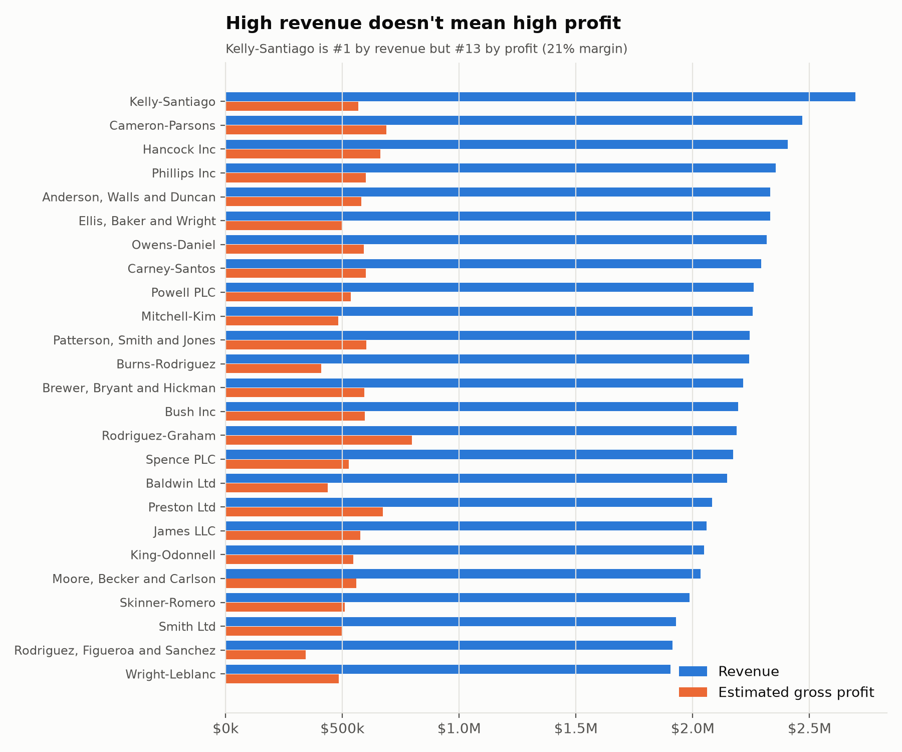
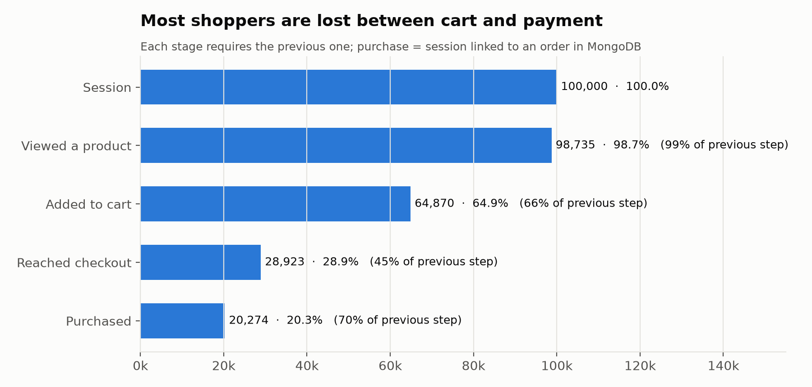
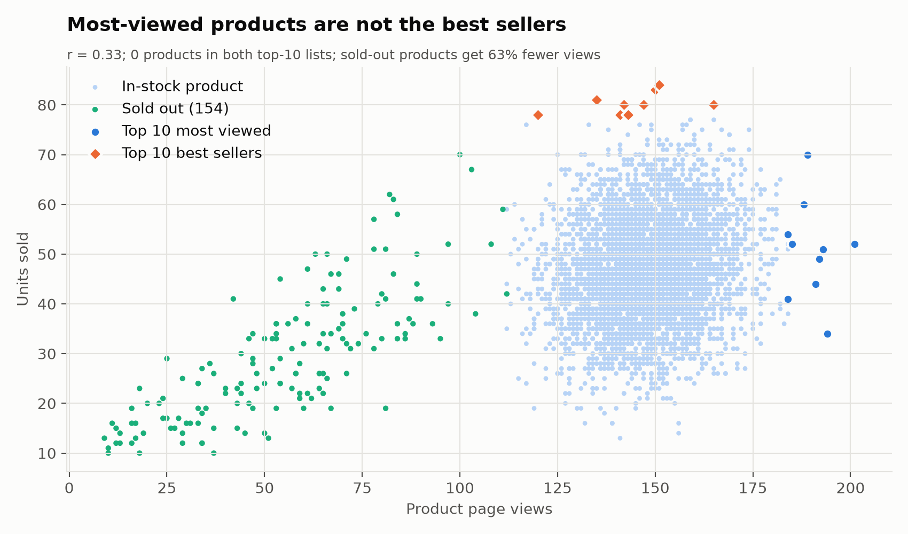
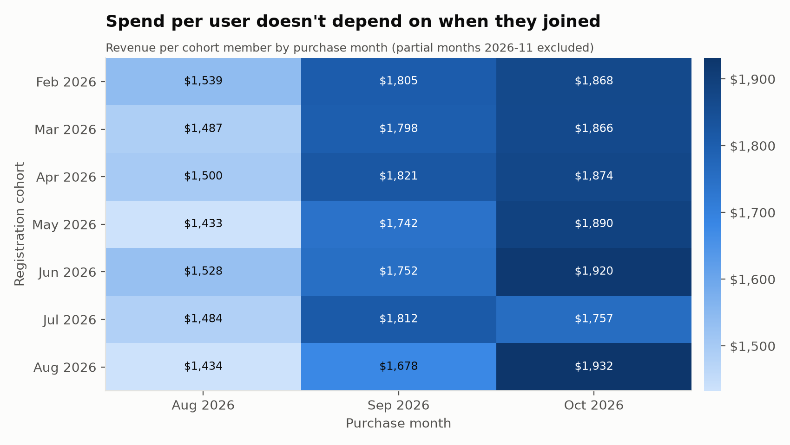
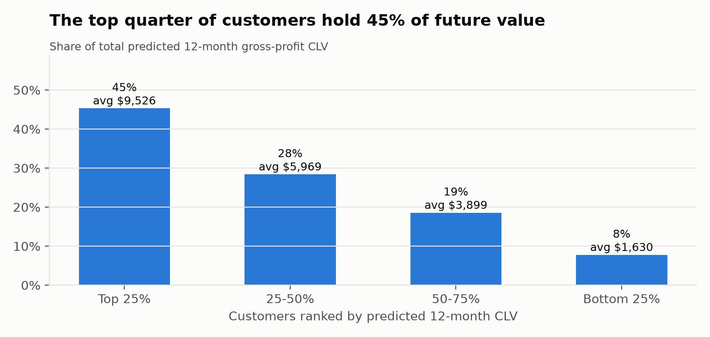
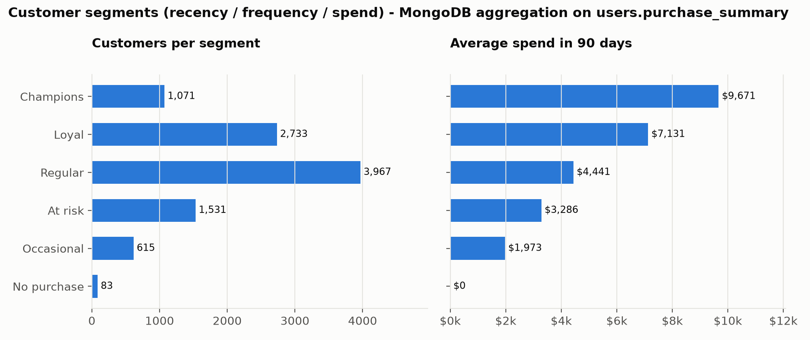

# 1. Overview and architecture

This project builds an analytics system for a synthetic e-commerce platform (10,000 users, 5,000 products, 25 categories) using three technologies, each chosen for the data and queries it handles best:

- **MongoDB** stores entities that are read as a whole and contain nested parts: the product catalog, user profiles and orders with their line items.
- **HBase** stores high-volume, append-only, time-ordered data that is read by key range: each user's browsing sessions and each product's daily performance counters.
- **Apache Spark** does everything that needs a full pass over the data or a join across stores: cleaning, cohort analysis, recommendations, SQL analytics and the integrated funnel and customer-lifetime-value (CLV) analysis.

{width=82%}

All results in this report come from a 10% scale run of the course generator: 200,000 sessions (about 2 million page views) and 50,000 transactions spanning 5 August to 3 November 2026. The generator's logic is unchanged. I only added a `--scale` option, because the full 2 million sessions need 15–20 GB of RAM in the generator, and seeded IDs so that runs are reproducible.

# 2. Data quality findings

The Spark cleaning job (Section 4) checks the raw data and writes `output/data_quality_report.json`. Five issues matter for the analysis:

| Issue | Count | Handling |
|---|---|---|
| Products have no `subcategory_id` (the brief's sample shows one) | 5,000 | Derived deterministically: CRC32(product_id) mod number of subcategories. MongoDB and Spark compute the same value. |
| Country is random but state is always a US code | 9,952 of 10,000 users | Flagged `geo_consistent = false`; geography is not used for conclusions. |
| Sessions marked `converted` with no order | 15,338 | The generator stops creating orders once its transaction target is reached. The funnel uses real orders, not the label. |
| Orders not linked to any session | 24,807 (49.6%) | Kept for revenue and CLV; excluded from session-level conversion. |
| No age field on users | all | Segmentation uses purchase behaviour (RFM) instead of age. |

Order header totals were also checked against their line items (subtotal and subtotal − discount): there were zero mismatches.

# 3. Data modeling

## 3.1 MongoDB: document model

| Collection | Shape | Why |
|---|---|---|
| `products` | Product with an **embedded** `category {id, name}` and `subcategory {id, name, profit_margin}`, plus an embedded `price_history` array | A product page or report needs the hierarchy every time. Categories rarely change, so copying 3 small fields avoids a `$lookup` on every read. |
| `categories` | Category with embedded `subcategories` | Small reference collection (25 documents); the source of truth for margins. |
| `users` | Profile + embedded `purchase_summary {total_orders, total_spent, avg_order_value, first/last_purchase}` | A profile view or segmentation needs one document read instead of scanning the order history. The summary is recomputed by an aggregation after each load. |
| `transactions` | Order with **embedded** `items[]`; each item stores a snapshot of `category_id` and `subcategory_id` | Line items never exist without their order and are always read with it. The snapshot keeps historical revenue-by-category correct even if a product is later re-categorised. |

The guiding rule was: **embed what is read together and owned by the parent; reference what is shared and large** (users are referenced from orders by `user_id`, not embedded). The indexes follow the query patterns: `transactions {user_id, timestamp}` for a customer's order history, `{timestamp}` for date ranges, a multikey index on `items.product_id` for product-level queries, and `users {purchase_summary.total_spent}` for value-ranked lists.

**Aggregation pipelines** (`mongodb/aggregations.py`):

1. **Revenue and estimated profit by category and month.** `$unwind` the items, `$group` by subcategory and month, `$lookup` the category, then pull the subcategory's margin out of the embedded array with `$filter` and `$arrayElemAt` before rolling up to the category.
2. **RFM customer segmentation.** Reads the embedded `purchase_summary`, computes recency, assigns a segment with `$switch`, then aggregates size and spend per segment.
3. **Product popularity.** One `$group` per product, then `$facet` produces the top 10 by units *and* the top 10 by revenue in a single pass, each enriched with `$lookup`.

| Segment (MongoDB pipeline 2) | Customers | Avg orders | Avg spend (90 days) |
|---|---|---|---|
| Champions (≥8 orders, bought in last 14 days) | 1,063 | 9.0 | $9,645 |
| Loyal (≥6 orders) | 2,741 | 6.7 | $7,149 |
| Regular | 3,967 | 4.1 | $4,469 |
| At risk (no order for 30+ days) | 1,538 | 3.0 | $3,222 |
| Occasional (≤2 orders) | 608 | 1.8 | $1,936 |
| No purchase | 83 | 0 | $0 |

## 3.2 HBase: wide-column model

**Table `user_sessions`.** Row key: `user_id # reverse_timestamp # session_id`.

- The `user_id` prefix keeps all of a user's sessions contiguous, so "this user's activity" is one range scan, never a full table scan.
- `reverse_timestamp = Long.MAX − epoch_ms` (zero-padded to 19 digits) makes the **newest session sort first**. "Last 5 sessions" is a prefix scan with `LIMIT 5` that stops after five rows.
- `session_id` at the end keeps keys unique if two sessions start in the same millisecond.

There are three column families, grouped by how they are read:

- `s` holds the session summary (device, referrer, status, duration, page count). It is small and read by almost every query.
- `p` holds the page views, **one column per view** (`p:000`, `p:001`, …), each storing `timestamp|page_type|product_id|category_id|duration`. Sessions have 4 to 16 views, so the table is naturally wide and sparse. HBase stores only the cells that exist.
- `c` holds the cart, one column per product in the cart. Most sessions have none.

A query for session summaries asks only for family `s`, so page-view bytes are never read from disk or sent over the network. The table is pre-split at `user_002000 … user_008000` so that writes are spread across regions from the start. `VERSIONS => 1` because sessions are immutable events.

**Table `product_metrics`.** Row key: `product_id # yyyyMMdd`, one family `m` with `views`, `cart_adds`, `purchases`, `units_sold` and `revenue`. A scan from `prod_00123#20261001` to `prod_00123#20261016` returns that product's daily time series in date order, which is exactly what a view-to-purchase trend chart needs.

Implemented queries (`hbase/query_hbase.py`, `hbase/sample_queries.hbase`) are recent sessions per user, sessions in a time window, one session's full journey (a single-row GET of families `p` and `c`), and a product's daily metrics with its view-to-purchase rate. For example, user_000042's newest session (sess_03f94afe79) shows category → 3 product pages → cart → checkout → confirmation, with 2 units of prod_03760 in the cart. 100,000 sessions (one generator file) were loaded, producing 269,295 product-day metric rows.

## 3.3 Why this split?

| Data | Store | Reason |
|---|---|---|
| Products, categories | MongoDB | Rich nested documents, flexible ad-hoc queries, small volume. |
| Users | MongoDB | Profile and summary read together; secondary indexes for segment queries. |
| Transactions | MongoDB | Order + items is one unit; aggregation pipelines cover revenue analytics. |
| Sessions / page views | HBase | Largest and fastest-growing data (≈10 page views per session); write-once; always read as "one user over a time range", which is precisely a row-key range scan. |
| Daily product metrics | HBase | Time series keyed by entity and date; counters fit wide-column storage. |

Sessions could also be stored as MongoDB documents, but at production scale (millions of sessions per day) HBase's sorted, range-partitioned storage and cheap sequential writes fit the access pattern better. MongoDB would need a compound index the size of the data to serve the same scans.

# 4. Spark processing pipeline

**Job 1: clean and normalise** (`spark/01_clean_normalize.py`). The generator writes each file as a single JSON array, so Spark reads it with `multiLine=true` and **explicit schemas**. Schema inference would read the 400 MB of session files an extra time. It would also turn `cart_contents`, whose keys are product IDs, into a struct with one field per product; the explicit schema declares it as a `MapType` instead.

The job then:

- converts strings to timestamps (UTC);
- trims and normalises the case of codes;
- drops rows with no key and duplicate IDs;
- sets impossible negative values to null;
- recomputes money fields and flags any mismatch;
- flattens the nested data into nine Parquet tables.

`page_views` (≈2M rows) is **partitioned by `event_date`** so that date-range queries skip whole directories (partition pruning), the same idea as HBase's time-ordered keys. Small dimension tables (categories, products) are joined with **broadcast joins** to avoid shuffling the large side.

**Job 2: cohort analysis.** Users are grouped by registration month. For every purchase month the job computes active buyers, orders, revenue and revenue per cohort member; dividing by cohort size makes cohorts of different sizes comparable.

**Job 3: recommendation indicators.** "Bought together" pairs come from a self-join of order items on `transaction_id` with `product_x < product_y`, so each pair is generated once. "Viewed together" pairs come from the same join on session product views. For each pair the job computes support, confidence and lift, and a blended score ranks the top 5 recommendations for the 20 best sellers.

**Spark SQL** (`spark/04_spark_sql_analytics.py`). Cleaned tables are registered as views named after the system that would hold them (`mongo_transactions`, `hbase_page_views`, …), and six queries use CTEs, multi-way joins and window functions (`RANK`, `ROW_NUMBER`, `NTILE`, and a moving average with `ROWS BETWEEN 3 PRECEDING`). The headline query joins HBase page views, HBase carts and MongoDB order items per category to compare views, carts, sales and profit. Its physical plan (`output/spark_sql_category_performance_plan.txt`) confirms that Spark chose broadcast hash joins for the small tables.

**Optimisation choices.** Explicit schemas; columnar Parquet; date partitioning; broadcast joins; `spark.sql.shuffle.partitions = 8` instead of the default 200 (which would create hundreds of tiny tasks at this size); Adaptive Query Execution enabled; `cache()` on datasets reused by several aggregations. The full pipeline runs in about 5 minutes on a 2-core laptop.

# 5. Integrated analytics

`integration/funnel_clv_analysis.py` answers two business questions by combining HBase (behaviour) and MongoDB (money) in Spark.

**Reading strategy.** HBase sessions are read **in parallel**: Spark distributes the list of region key ranges, and each partition opens its own Thrift connection and scans only its range (`mapPartitions`), so the read scales with the number of executors. MongoDB orders, users and margins are read with pymongo using projections, so only the needed fields are transferred. The official MongoDB Spark Connector would be the production choice. A `--source files` mode reads the cleaned Parquet so that results are reproducible without the databases running.

**A. Funnel question.** *Where do shoppers drop out between viewing a product and paying, and does it differ by device, traffic source or category?*

1. Page views from HBase give "viewed a product" and "reached checkout".
2. The cart family gives "added to cart".
3. MongoDB orders joined on `session_id` give "paid".

Each stage requires the previous ones, so this is a strict funnel. Using the order in MongoDB rather than the session's `converted` label is what exposed the 15,338 ghost conversions described in Section 2.

**B. CLV question.** *Which customers will be worth the most over the next year, and does engagement predict it?*

**Predicted 12-month CLV = average order value × orders per year × gross margin × retention**, where:

- **average order value** comes from MongoDB orders;
- **orders per year** is the 90-day order count scaled to 365 days;
- **gross margin** is each order's margin, weighted from subcategory margins in MongoDB;
- **retention** is 1.0 if the last order was within 30 days, 0.6 if within 60 days, and 0.3 otherwise.

Engagement (session count, duration, pages, cart rate) comes from HBase. Spark joins the sources, ranks customers into quartiles with `NTILE(4)` and computes correlations.

# 6. Findings and business insights

{width=62%}

**Sales are stable.** Weekly revenue holds at about $4.2M (≈3,900 orders, average order value ≈$1,075) with no trend or seasonality. This is expected for a uniform generator, but it means any future change can be measured against a flat baseline.

{width=60%}

**Revenue rank ≠ profit rank.** Kelly-Santiago is the #1 category by revenue ($2.70M) but only #13 by estimated profit, because of its 21% margin. Rodriguez-Graham is #15 by revenue but #1 by profit (36.5% margin, $0.80M). Category margins range from 17.9% to 36.5%. *Action:* rank merchandising and ad spend by profit, not revenue, and promote high-margin categories more.

{width=64%}

**The funnel leaks after the cart.** Of 200,000 sessions, 98.7% view a product and 64.8% add to cart, but only 28.9% reach checkout and 12.6% pay. More than half the carts never reach checkout (55% drop), and 56% of checkouts don't end in a paid order.

That last figure is partly a generator artefact: in the first 100,000 sessions, which have complete order data (the subset loaded into HBase), checkout-to-payment is 70%. Conversion is the same across devices (12.6–12.9%) and traffic sources (12.1–13.0%), so the problem is the checkout flow itself, not a channel. *Action:* cart-abandonment emails and a shorter checkout are the highest-leverage fixes.

{width=62%}

**Popularity ≠ sales, and stock-outs hide products.** Views and units sold correlate only weakly (r = 0.33), and none of the 10 most-viewed products are among the 10 best sellers. The clearest pattern is the green cluster: the 154 sold-out products received 63% fewer page views. The site stops showing products as stock runs out, so a stock-out loses sales *before* the product reaches zero. *Action:* trigger reorders from the view trend in HBase's `product_metrics`, not only from stock level.

{width=55%}

**Cohorts behave the same.** Revenue per cohort member varies by only about 6% across registration months ($5,159–$5,469 over the 90 days), and 99% of every cohort bought something. In real data this heatmap would reveal onboarding or retention effects; here it confirms that the generator gives every user the same purchase behaviour.

{width=55%}

**Value is concentrated, and engagement doesn't predict it.** The top 25% of customers hold 46% of predicted 12-month value (average $9,530 vs $1,597 for the bottom quarter). Correlation with CLV is strong for order count (r = 0.82) and average order value (0.43), but weak for session count (0.15) and essentially zero for time on site (0.005). *Action:* target retention offers using purchase history from MongoDB; browsing time alone is a poor signal of value.

**Recommendations need real affinity.** Only 696 directed product pairs were bought together at least twice in 50,000 orders (maximum 3 times), and 4,236 pairs were viewed together at least 3 times (maximum 5). Lift values look large (up to 320), but they come from very small counts, because the generator picks basket items at random. The pipeline is correct; in real data a minimum-support threshold (for example, at least 20 co-purchases) would be needed before showing these to customers.

{width=66%}

# 7. Technology selection summary

| Analytical task | Technology | Why |
|---|---|---|
| Revenue by category/month, RFM segments, top products | MongoDB aggregation | Data already in nested documents; runs where the data lives; uses indexes. |
| User's recent activity, time-window lookups, product daily series | HBase scans | Row-key design turns each query into one short, sorted range scan. |
| Cleaning 2M page views, cohort, market-basket pairs | Spark | Full passes and self-joins over the whole dataset need distributed processing. |
| Cross-store funnel and CLV | Spark + both stores | Only Spark can join behaviour (HBase) with money (MongoDB) at scale. |

# 8. Scalability

- **MongoDB.** Shard `transactions` on a hashed `user_id` (even writes; a user's orders stay on one shard), keep `products`/`categories` unsharded (small). Pipelines start with `$match` on indexed fields and use `allowDiskUse` for large groups. The embedded purchase summary should move from a batch recompute to an update on each order (or a change-stream consumer).
- **HBase.** Pre-split regions spread writes. At high volume, a salt prefix (`hash(user_id) mod N`) avoids hot regions for very active users. Page views could move to a separate table keyed `product_id # reverse_ts` if per-product clickstreams become a main query. Compression (Snappy) and TTLs on old sessions control storage.
- **Spark.** All jobs use DataFrame operations that scale out unchanged. At full scale, use the MongoDB Spark Connector and an HBase–Spark connector for pushed-down, partition-aware reads; raise shuffle partitions; and replace the exact pair self-join with FP-Growth (`pyspark.ml.fpm`) for large baskets.
- **Generator.** The provided generator keeps everything in memory; streaming JSON Lines output would remove the RAM limit.

# 9. Limitations and future work

- The data is synthetic and uniform: no seasonality, no channel or device effect, random baskets. Several "no difference" findings reflect the generator, not real behaviour. The methods are the deliverable; the same pipeline on real data would show real effects.
- Only one of the two session files (100,000 sessions) was loaded into HBase. Spark analysed all 200,000 from Parquet.
- The CLV model is a simple heuristic (no churn model or discounting). A BG/NBD + Gamma-Gamma model would be the next step.
- Revenue by category uses item subtotals before order-level discounts (discounts average about 2.5% of revenue).
- Future work:
  - streaming ingestion of page views (Kafka → Spark Structured Streaming → HBase counters);
  - ALS collaborative filtering on the view and purchase matrix;
  - a dashboard on top of `product_metrics`.

# Appendix: reproducing the results

See `README.md`: `docker compose up -d && ./run_all.sh`, or `SKIP_DB=1 ./run_all.sh` without the databases. On Windows: `setup_windows.ps1` once, then `run_all.ps1` (or `run_all.ps1 -SkipDb`). All numbers in this report come from the files in `output/`.
